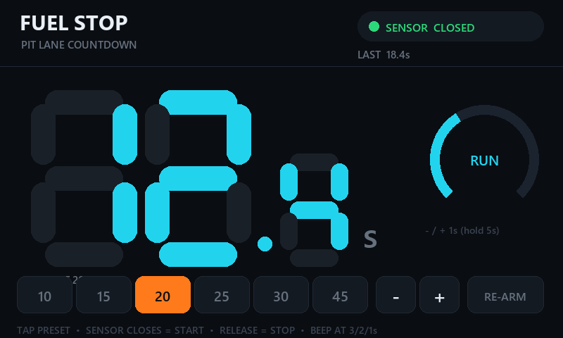

# 赛车加油计时器 · Fuel Stop Timer

基于 **ESP32-S3-Touch-LCD-4.3C** 的进站加油倒计时器：接触式传感器压到位即开始倒计时，最后 3 秒逐秒报警，松手立即停表并显示本次真实用时。



## 功能

- **预设 + 自定义**：底部 6 个快捷档（10/15/20/25/30/45 秒），另可用 `[−] / [+]` 微调（单击 ±1s，长按 ±5s，范围 1–99s）
- **0.1 秒精度**：三位七段数码管（自绘，任意尺寸都锐利），大字 `20.0 → 0.0`
- **超时负计时**：越过 0 继续显示 `-0.1 / -1.2 …`（左侧负号），提示已经超目标
- **松手即停**：显示本次真实总时长（可能大于预设），并更新右上角 `LAST`
- **误触保护**：触发短于 1.5 秒视为误触，不显示成绩、不更新记录，直接回到待触发
- **最后 3 秒报警**：3/2/1 秒各响一声（音量 100 + 功放预热），数字与环形进度转红，**不做整屏闪烁**
- **现场验线**：右下角实时显示隔离输入电平与跳变次数

## 硬件

| 部件 | 型号 / 接口 |
| --- | --- |
| 主控 | ESP32-S3-WROOM-1-N16R8（16 MB Flash / 8 MB OPI PSRAM） |
| 显示 | 4.3" 800×480 RGB565，ST7262 面板 |
| 触摸 | GT911（I2C） |
| 音频 | ES8311 + 板载功放（I2S1），接外接扬声器 |
| IO 扩展 | CH422G（背光 / 触摸复位 / 功放使能 / 隔离 DI-DO） |
| 传感器 | NPN 常开接触式，接板载隔离输入 **DI1** |

## 接线（传感器三线）

| 传感器线 | 接到端子 |
| --- | --- |
| 棕（+V） | `5V` |
| 蓝（0V） | `GND` |
| 黑（输出） | **`DI1`**（最下面那颗） |

> 本机 **DI0 通道按压无响应**（硬件问题），固件默认只认 DI1；`fuel_timer.c` 里 `SENSOR_USE_DI0/1` 可切换。

详见 [firmware/README.md](firmware/README.md)（含端子顺序、NPN/PNP 排查、外部蜂鸣器接法）。

## 目录结构

```
.
├── docs/
│   ├── board-esp32-s3-touch-lcd-4.3c.md   板卡资料（引脚/外设/示例索引）
│   └── ui_preview.png                     界面预览
└── firmware/                              ESP-IDF v6.1 工程
    ├── main/                              ui / seg7 / fuel_timer / buzzer
    ├── components/                        Waveshare BSP + 本地化 esp_codec_dev
    ├── sdkconfig.defaults                 16MB Flash / 8MB OPI PSRAM / LVGL 字体
    ├── dependencies.lock                  锁定 lvgl 9.2.0
    └── README.md                          接线、操作、可调参数
```

## 编译与烧录

```powershell
# 激活 ESP-IDF 环境（本机为 EIM 安装的 v6.1）
& C:\Espressif\tools\Microsoft.v6.1.PowerShell_profile.ps1

cd firmware
idf.py -p COM8 build flash monitor     # monitor 内按 Ctrl+] 退出
```

首次构建会从 components.espressif.com 拉取 `lvgl 9.2.0`（`esp_codec_dev` 已本地化在 `components/` 内）。

## 可调参数

集中在 [`firmware/main/fuel_timer.c`](firmware/main/fuel_timer.c) 顶部：

| 参数 | 默认 | 说明 |
| --- | --- | --- |
| `PRESET_DEFAULT_MS` | 20000 | 默认预设 |
| `WARN_MS` | 3000 | 报警起始（最后 3 秒） |
| `BEEP_LEN_MS` | 250 | 每声长度（太短会被功放唤醒延迟吞掉） |
| `AMP_WARMUP_MS` | 5000 | 提前打开功放的时刻 |
| `MIN_RUN_MS` | 1500 | 短于此时长视为误触 |
| `PRESS_CONFIRM_MS` / `RELEASE_CONFIRM_MS` | 50 / 150 | 消抖确认时间（不影响计时精度，计时用原始边沿时间戳） |
| `AUTO_REARM_MS` | 5000 | 结束后自动待触发延时 |

## 说明

- 计时起点/终点使用**原始电平边沿的时间戳**，消抖只影响“认不认”，不会让成绩多算或少算。
- 出厂固件已完整备份（16 MB），可随时刷回。
- 工程由 [`examples/esp-idf`](docs/board-esp32-s3-touch-lcd-4.3c.md) 官方例程改造，已适配 ESP-IDF 6.1 的组件拆分（`gpio` → `esp_driver_gpio`、`on_bounce_frame_finish` → `on_frame_buf_complete` 等）。